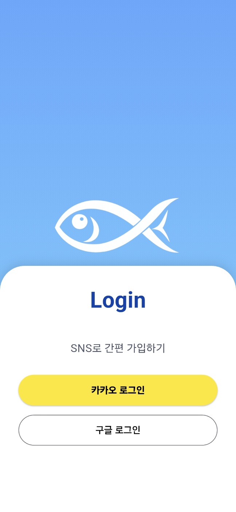
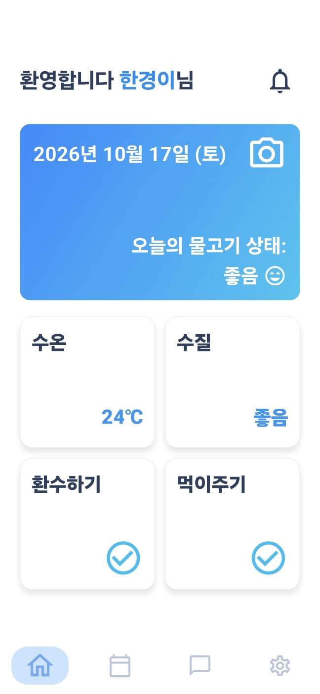
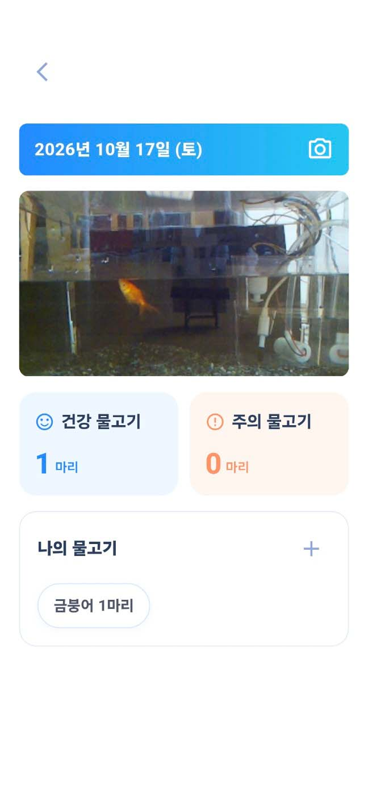
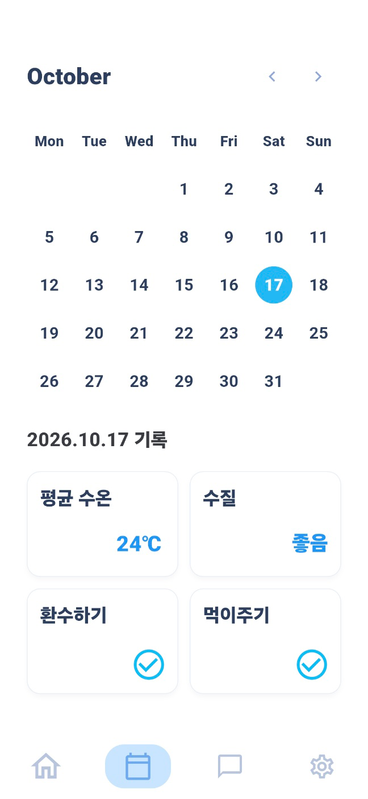
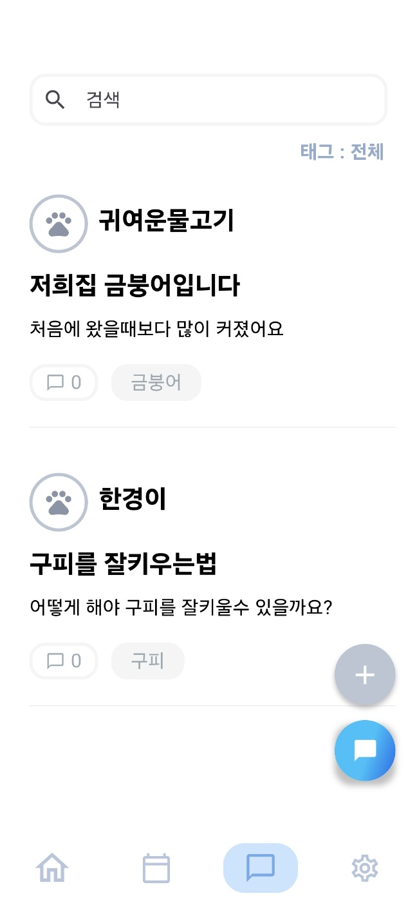
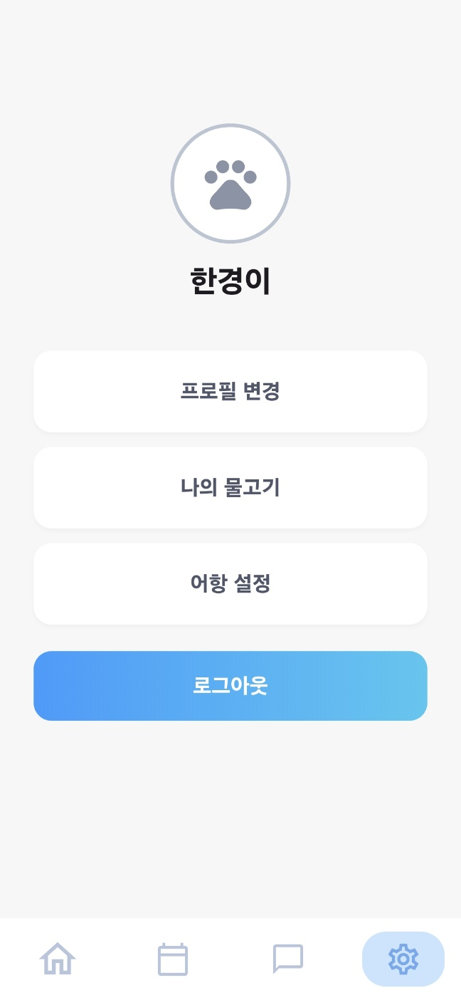
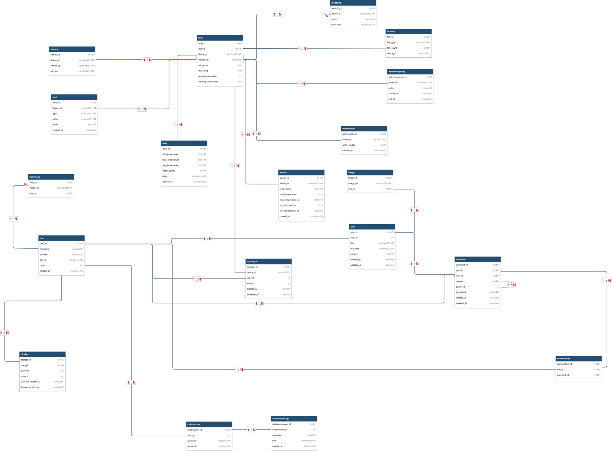

# 🐠 관상어용 스마트 어항 시스템
본 프로젝트는 IoT와 AI 기술을 활용하여 관상어의 사육 환경을 효율적으로 관리할 수 있도록 돕는 스마트 어항 관리 시스템입니다.
사용자는 모바일 애플리케이션을 통해 어항의 실시간 영상과 수온 및 수질 상태를 확인할 수 있으며, 원격 먹이 급여 및 환수 기능을 통해 언제 어디서나 어항을 관리할 수 있습니다.
또한 AI 기반 영상 분석을 통해 물고기의 어종과 개체 수를 인식하고 움직임을 분석하여 활동성 이상 여부를 판단합니다. 이외에도 어항 상태 및 관리 이력 조회, 사용자 간 정보 공유를 위한 커뮤니티, 어항 관리에 관한 질문을 지원하는 AI 챗봇 기능을 제공하여 보다 편리하고 체계적인 관상어 관리 환경을 구축하고자 합니다.

## 📅 프로젝트 정보
| 항목 | 내용 |
|:---:|:---:|
| 개발 기간 | 2026.01 ~ 2026.11 |

## 🏃 팀 구성 및 담당 역할
|개발자|기능 담당|
|---|---|
|김서원(팀장)|IoT기능 개발,프론트엔드 UI개발|
|이다경|IoT기능 개발, 물고기 행동 분석 AI개발 및 AI서버 담당, 프론트엔드 UI개발 보조|
|유승엽|백엔드 서버 개발,프론트엔드 UI개발 보조|

## 📖 개요
1. 개발 배경 및 목적
2. 주요 기능
3. 서비스 화면
4. 시스템 구조도
5. ERD
6. 기술 스택
7. Repository

## 💡 1. 개발 배경 및 목적
본 시스템은 사용자가 시간과 장소에 관계없이 모바일 앱을 통해 어항을 원격으로 관리하고, AI를 활용하여 물고기의 상태를 확인할 수 있도록 하는 것을 목표로 합니다. 이를 통해 지속적인 어항 관리가 어려운 사용자들의 부담을 줄이고, 물고기의 이상 징후를 조기에 파악하여 보다 편리하고 안정적인 관상어 사육 환경을 제공하고자 합니다.

## 🚀 2. 주요 기능
- 실시간 모니터링: 어항 영상 및 수온·수질 상태 실시간 확인
- 원격 어항 제어: 모바일 앱을 통한 먹이 급여 및 환수 제어
- AI 물고기 분석: 물고기 어종 및 개체 수 인식
- 활동성 분석: 물고기의 움직임 분석을 통한 활동성 이상 탐지
- 어항 관리 기록: 수온·수질 데이터 및 급여·환수 이력 조회
- AI 챗봇: 어항 관리 및 관상어 관련 질문 응답
- 커뮤니티: 사용자 간 사육 정보 및 경험 공유

## 🖼️ 3. 서비스 화면

  
  
  

  
  
  

## 🏗️ 4. 시스템 구조도

  

## 🗄️ 5. ERD

  

  <tr>
    <th align="center">구분</th>
    <th align="center">기술 스택</th>
  </tr>
  <tr>
    <td align="center">프론트엔드 (모바일)</td>
    <td>Dart, Flutter</td>
  </tr>
  <tr>
    <td align="center">백엔드 (서버)</td>
    <td>JavaScript, Node.js, Express.js</td>
  </tr>
  <tr>
    <td align="center">Database / ORM</td>
    <td>MySQL 8.0, Sequelize</td>
  </tr>
  <tr>
    <td align="center">인증</td>
    <td>JWT, Kakao OAuth 2.0, Google OAuth 2.0</td>
  </tr>
  <tr>
    <td align="center">실시간 통신</td>
    <td>WebSocket (ws)</td>
  </tr>
  <tr>
    <td align="center">실시간 스트리밍</td>
    <td>MediaMTX, RTSP, WebRTC</td>
  </tr>
  <tr>
    <td align="center">AI 서버</td>
    <td>Python, FastAPI</td>
  </tr>
  <tr>
    <td align="center">인프라</td>
    <td>AWS EC2, Docker, Docker Compose</td>
  </tr>
  <tr>
    <td align="center">버전 관리</td>
    <td>Git, GitHub</td>
  </tr>
</table>

## 📂 7. Repository
|Repository|Description|Github|
|---|---|---|
|Frontend|Flutter 기반 모바일 애플리케이션|
|
|Backend|Node.js 기반 API 서버 및 데이터 관리|
|
|AI Server|AI 영상 분석 및 물고기 인식 서버|
|
|IoT|Raspberry Pi 기반 센서 및 장치 제어|
|

### 실행 방법
    
#### 1.파일 받아오기

    git clone https://github.com/ksw2003/fishapp_main.git
    cd fishapp_main

#### 2. .env파일을 작성한다
    env파일을 만든 후 .env-example.text를 참고하여 작성해줍니다.

#### 3.서버 폴더를 가져온다.

    git clone https://github.com/ysy03/fishTankServer.git backend

#### 4.서버 환경 설정한다.

    https://github.com/ysy03/fishTankServer.git
    이동후 readme설명에 따라 .env파일 생성

### 5. docker-compose 실행

    docker compose up -d --build

### 6. 컨테이너 확인

###### 실행중인 컨테이너 확인

    docker ps

###### 로그 확인 

    docker compose logs -f backend-server

###### docker-compose 실행 종료

    docker compose down
